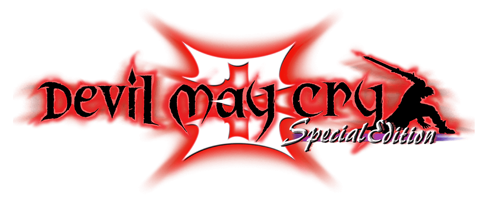
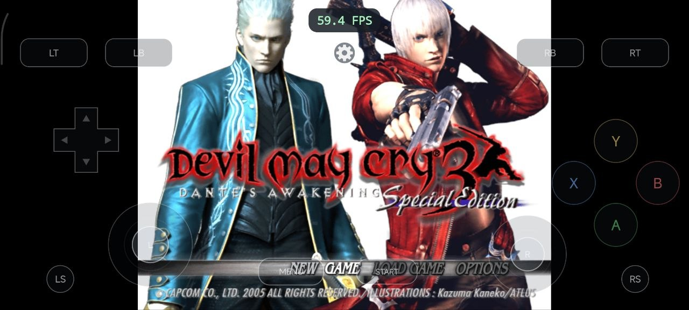
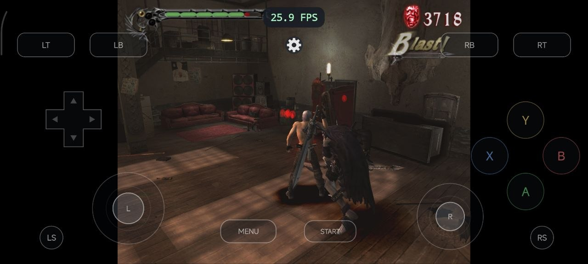
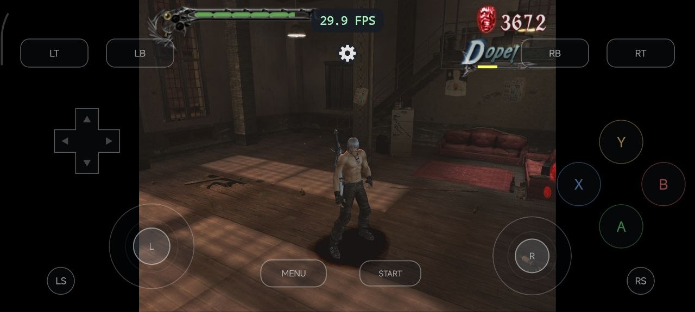
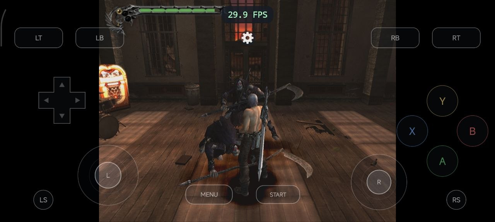
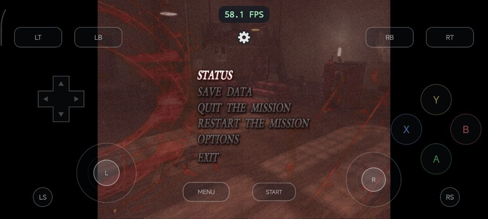
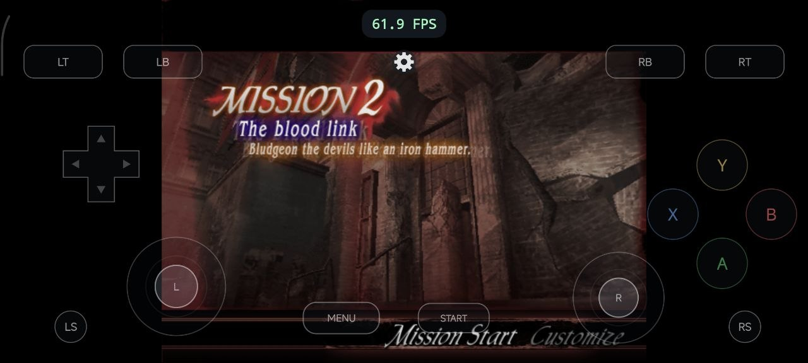

  

<h3 align="center">An experimental Android recompilation preview</h3>

  <a href="#android-build">Build</a> ·
  <a href="docs/INSTALLATION.md">Installation</a> ·
  <a href="docs/CONTROLS.md">Controls</a> ·
  <a href="docs/STATUS.md">Status</a> ·
  <a href="CHANGELOG.md">Changelog</a>

This is A static Recompilation of the game **Devil May Cry 3: Special Edition** From PC to Android ARM64, The runtime translates the game's Windows and Direct3D 9 interfaces, renders through DXVK Native and Vulkan, and plays its audio through AAudio.

**You must own the PC game and supply your own `dmc3se.exe` plus the complete
matching game folder. No original game files are included.** Read the
[game ownership and compatibility disclaimer](docs/DISCLAIMER.md).

This is a work in progress. User-supplied Android captures show Dante gameplay,
combat, the pause menu, and the Mission 2 briefing. They do not establish complete
campaign compatibility. See [what has been verified](docs/STATUS.md).

## Android build

**v0.28 — icon, naming, and widescreen settings** · October 30, 2026

| Package | Architecture | Status |
| --- | --- | --- |
| DMC3 | ARM64 / `arm64-v8a` | Experimental development build |

[Download the ARM64 APK](https://github.com/sindufha/Devil-may-cry-3-recomp/releases/download/v0.28/DMC3-Android-arm64-v0.28.apk)
· [Release notes](https://github.com/sindufha/Devil-may-cry-3-recomp/releases/tag/v0.28)
· [SHA-256 checksum](docs/SHA256SUMS)

The APK is **51.01 MiB**, ARM64 only. This is an experimental prerelease.
Package details, runtime versions, and the supported EXE fingerprint are in
[Build information](docs/BUILD-INFO.md). This repository publishes documentation,
screenshots, and APK previews; the full source workspace is not published here.

Supply your own matching PC executable and full game folder. The APK contains
recompiled code, runtime components, GPU support, and app branding. It contains
no original executable, game archives, gameplay textures/models, music, movies,
or save data. The screenshots below are documentation images only.

## Features

- **Vulkan rendering:** Direct3D 9 through DXVK Native 2.6.2, with bundled
  Turnip and an option to select the system GPU driver.
- **Game audio:** original music and effects through the DirectSound/Vox bridge
  and AAudio mixer.
- **Xbox-style touch controls:** both sticks, D-pad, A/B/X/Y, shoulders,
  triggers, stick clicks, and separate MENU and START buttons.
- **Custom interface:** move all 16 controls, resize each from 50–200%, pinch
  to resize, and save or reset your layout. Complete controls stay within the
  usable screen area, including notch insets.
- **Aspect ratio:** Widescreen 16:9 and Original 4:3, with camera/HUD corrections
  and live switching in MENU > Graphics > Aspect Ratio.
- **Session settings:** 4:3 render sizes from 640×480 to 1600×1200, seven 16:9
  sizes from 854×480 to 1600×900, a top-center FPS display, and control preferences.
- **Save profiles:** normal and completed-save profiles, completed-save import,
  save history, and Select save. Unlock All uses a save you provide.
- **Android navigation:** a Back confirmation with Yes/No, and a retained session
  when the app is backgrounded while its process remains alive.
- **English launcher:** select the game EXE and data folder before starting.

## Screenshots

<table>
  <tr>
    <td> Title screen</td>
    <td> Dante combat</td>
  </tr>
  <tr>
    <td> Office gameplay</td>
    <td> Enemy encounter</td>
  </tr>
  <tr>
    <td> Original pause menu</td>
    <td> Mission 2 briefing</td>
  </tr>
</table>

Captured on the user's Android device. Click an image for its full size.
The visible gameplay readings are approximately 26–30 FPS; menu/briefing readings
are higher. These are individual screenshots, not a controlled performance test.

## Getting started

1. Install the ARM64 APK on a compatible Android device.
2. In the launcher, choose the supported `dmc3se.exe`.
3. Choose the game folder containing `GDATA.AFS`, `native/rom`, and `native/sound`.
4. Select a driver and optional save profile, then press **Start game**.

The development device is a **Poco F3, Android 13, Adreno 650, 6 GB RAM**.
Other devices and drivers have not been established as compatible. Android 9+
is needed for the bundled driver path; the GPU must meet the renderer's feature
requirements. Read the [installation guide](docs/INSTALLATION.md) before setup.

## Current limitations

The entire campaign, every mission, all character/mode combinations, and other
GPUs are unverified. There is no fixed frame-rate guarantee. Imported completed
saves determine which progression-dependent options appear. Background process
termination cannot restore an unsaved live session. New UI/input changes have
local regression evidence; they still need device confirmation.

Poco F3 with Snapdragon 870, Adreno 650, and 6 GB of ram gets around 30 FPS at average inside battle, with higher frame drop at more dense area, such as stage 2 and 3. Final stage is smooth at 60 FPS when dueling.

See [Status](docs/STATUS.md) and [Troubleshooting](docs/TROUBLESHOOTING.md) for
the distinction between screenshots, user reports, and local automated checks.

## Documentation

- [Installation, updates, and supported game files](docs/INSTALLATION.md)
- [Touch controls, custom layouts, and Android Back](docs/CONTROLS.md)
- [Widescreen settings, source patch, and validation](docs/WIDESCREEN.md)
- [Adaptive icon and application-name fix](docs/ICON-FIX.md)
- [Development status and validation](docs/STATUS.md)
- [Runtime architecture](docs/ARCHITECTURE.md)
- [Troubleshooting and useful bug reports](docs/TROUBLESHOOTING.md)
- [Build information and checksums](docs/BUILD-INFO.md)
- [Changelog](CHANGELOG.md)
- [Credits and third-party components](docs/THIRD-PARTY.md)
- [Game ownership and compatibility disclaimer](docs/DISCLAIMER.md)

## Credits

Built using [pcrecomp](https://github.com/sp00nznet/pcrecomp),
[DXVK](https://github.com/doitsujin/dxvk),
[libadrenotools](https://github.com/bylaws/libadrenotools), Mesa/Turnip, and
stb_vorbis. The Android compatibility/control work draws on
[NFSU2 Recompiled](https://github.com/codepdbh/nfsu2-recompiled).
The settings and layout-editor workflow takes inspiration from
[ShaolinMonks-Android](https://github.com/RanggaCasper/ShaolinMonks-Android).

Devil May Cry and its artwork belong to Capcom. This project is independent and
is not an official Capcom release. See [component and branding notices](docs/THIRD-PARTY.md).

## License

Original project material published in this repository is available under the
[MIT License](LICENSE). The original game, branding/artwork/screenshots, and
third-party components retain their respective rights and licenses.
