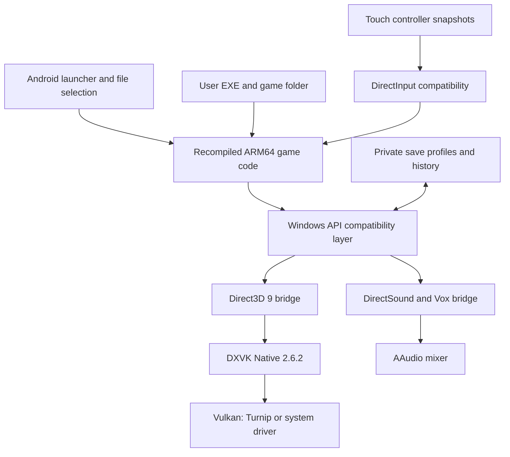

# Runtime architecture

[Back to overview](../README.md)

The supported PC executable is lifted into C and compiled ahead of time for
ARM64. At runtime, its original x86 instruction stream is not being executed by
a general-purpose CPU emulator. The imported EXE still supplies the verified
image data needed by the runtime; game archives/assets come from the user's folder.

The launcher uses Android's file picker and persistent folder permission.
Large assets are opened read-only through the Storage Access Framework.
Game execution uses a separate `:game` process; the launcher remains available
when a session exits.

Touch input publishes snapshots without UI-thread guest-memory access. The
game thread drains those snapshots into its DirectInput view. Settings route
resolution changes through the original game's window message/resource rebuild
path, and acknowledge the actual D3D9 backbuffer size.

When a surface disappears, the guest worker parks. DXVK's command stream is
drained and the old presenters are invalidated before detaching the window.
A new surface resumes the retained device and guest state. Explicit exit and
Activity destruction stop the session.

Runtime optimization includes local guest registers, resolved static transfers,
a hashed dispatch table, and cached compilation units. Incremental UI work can
reuse the native library; the branding build does so. The app remains subject
to compatibility-layer overhead and device-specific graphics behavior.
